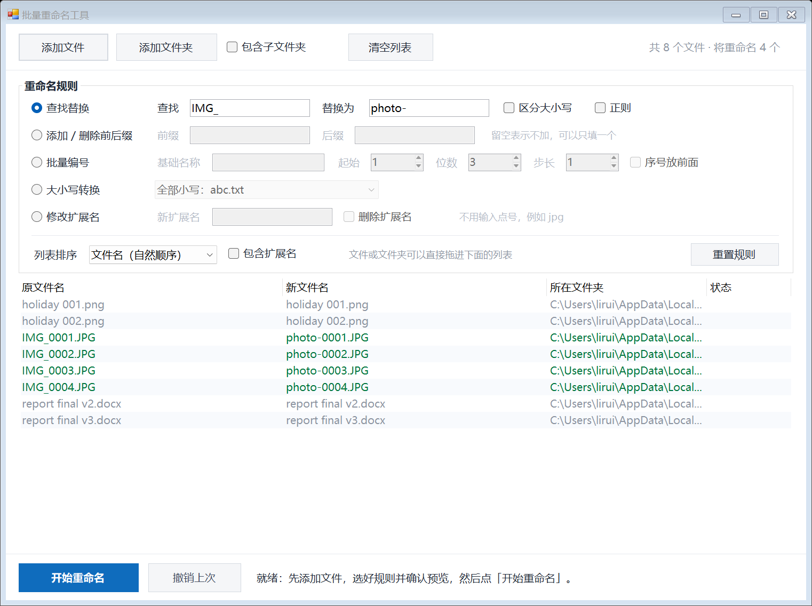

# 批量重命名工具

一个**免安装、绿色**的小工具：双击就能用。不联网，不写注册表，不产生垃圾文件。
用的是 Windows 自带的 PowerShell + WinForms，不需要额外安装任何东西。

**v2.0 更新**：支持高分屏（150% 缩放下文字也是清晰的，不再发虚）；界面重新排版，文字更简练、对齐更整齐。

## 三步上手

1. **双击 `启动.bat`** 打开工具（想完全不闪黑框，就双击 `启动(无黑框).vbs`）
2. 点【添加文件】/【添加文件夹】，或直接把文件、文件夹**拖进**列表；
   勾上【包含子文件夹】再选文件夹，子文件夹里的文件也会一起加进来。
3. 在【重命名规则】里选一种规则、填好参数 —— 下面的列表会**实时预览**结果，
   确认无误后点【开始重命名】。改错了就点【撤销上次】。

> 每个输入框都有悬停提示，鼠标停一下就知道该填什么。

## 五种规则

| 规则 | 说明 | 例子 |
|---|---|---|
| **查找替换** | 把文件名里的文字换成别的。勾【正则】可用正则表达式 | 查找 `IMG_` → 替换为 `照片-`：`IMG_0001.JPG` 变成 `照片-0001.JPG` |
| **添加 / 删除前后缀** | 在文件名开头或结尾加内容；要「删」就用查找替换（替换内容留空） | 前缀填 `2026_`：`a.txt` 变成 `2026_a.txt` |
| **批量编号** | 统一改成「基础名称 + 序号」，可设起始值、位数（补零）、步长，序号也能放前面 | 基础名称 `照片_`、起始 1、位数 3 → `照片_001.jpg`、`照片_002.jpg`… |
| **大小写转换** | 全部小写 / 全部大写 / 首字母大写 / 每个单词首字母大写 | `HELLO.TXT` → 全部小写 → `hello.txt` |
| **修改扩展名** | 换扩展名，或勾【删除扩展名】直接去掉扩展名 | `a.txt` → `a.md` |

另有一个全局选项 **包含扩展名**：勾上后扩展名也参与改名（对查找替换 / 前后缀 / 大小写生效）。

## 几个要点

- **排序很关键**：编号规则按列表顺序编号，所以先用【列表排序】定好顺序
  （文件名自然序 / 修改时间 / 文件大小 / 扩展名）。「自然顺序」会把 `2.png` 排在 `10.png` 前面。
- **冲突会自动拦下来**：新名字重复、目标文件已存在、含 `\ / : * ? " < > |`
  等非法字符时，那一行会**标红**并禁止执行，不会把文件改坏。
- **不会互相覆盖**：遇到「A 改成 B、B 改成 C」这种连锁或环形改名，
  工具会自动用临时名绕开，安全完成。
- **撤销**：每次执行都会记录，可以连续撤销多次。记录只存在内存里，
  关掉程序就没了 —— 所以执行前先看清预览。
- 列表上**右键**可以选择「在资源管理器中打开」或「从列表中移除」，
  选中后按 Delete 也能移除，双击某一行会打开它所在的文件夹。

## 常见问题

- **双击 `启动.bat` 没反应**：用右键「以管理员身份运行」再试，或检查杀毒软件是否拦截了 PowerShell。
  `启动(无黑框).vbs` 依赖 VBScript，个别被安全策略锁定的电脑会禁用。
- **界面大小**：窗口大小会按你的屏幕可用范围自动适配，也可以随时拖动边缘调整。
- **担心被杀毒软件拦**：工具就是明文 PowerShell 脚本（`BatchRename.ps1`），
  直接用记事本打开就能看，没有任何混淆或联网行为。
- **想改功能**：所有代码都在 `BatchRename.ps1` 里，注释齐全，直接编辑即可。

## 文件清单

| 文件 | 用途 |
|---|---|
| `启动.bat` | 主启动方式（双击即可） |
| `启动(无黑框).vbs` | 备用启动方式（完全不闪黑框） |
| `BatchRename.ps1` | 程序本体（单文件、纯文本） |
| `使用说明.md` | 就本文档 |
| `界面预览.png` | 界面截图 |